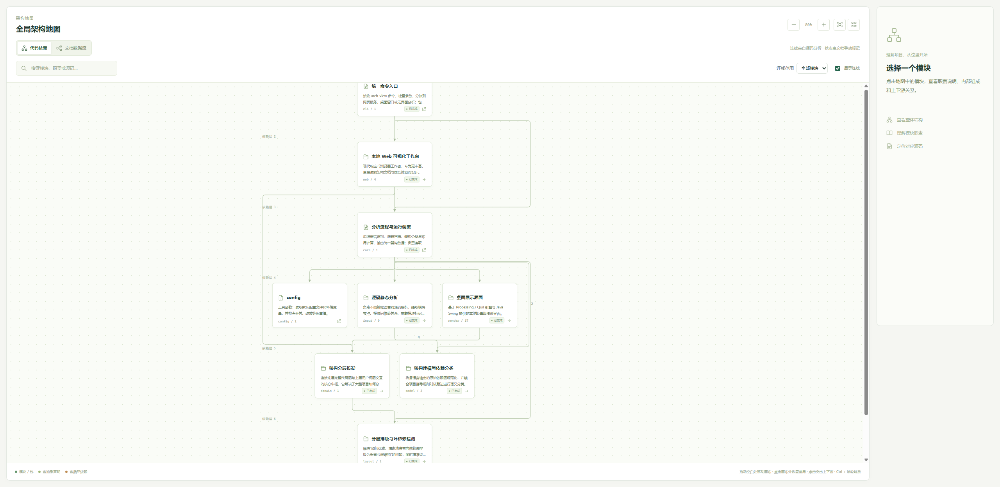
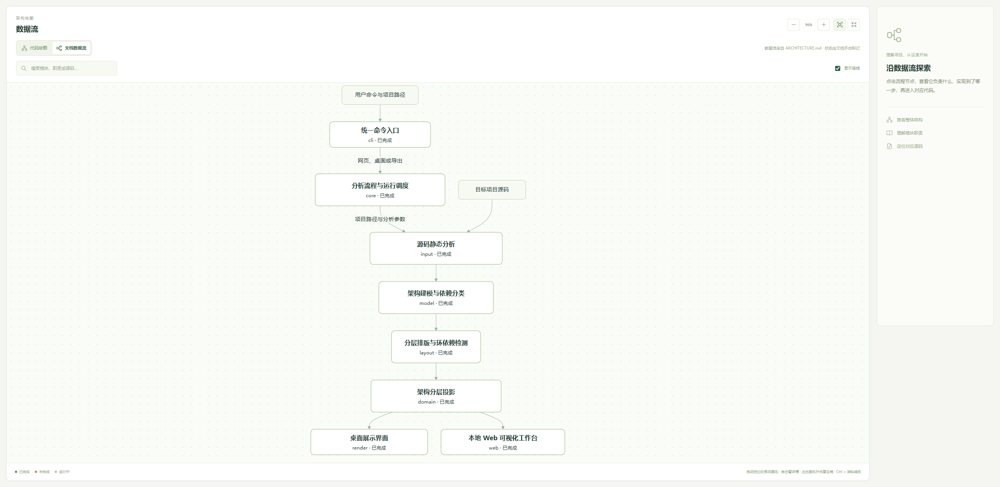

# Arch View

让开发者**随时看见真实架构**，在代码生长时拦住分层漂移、循环依赖和文档脱节，防止架构腐化。

它静态扫描 Clojure、Python、Kotlin、Java 源码，按真实依赖自动分层，把模块地图、循环依赖、`ARCHITECTURE.md` 职责说明和 Mermaid 数据流放进同一个本机工作台。下面两张图是 Arch View 分析自己：左边是源码依赖，右边是文档里的设计数据流。



*代码依赖 · `arch-view serve .` 扫描本仓库后的全屏地图。上层是入口与 Web，下层是建模、排版与环检测。*



*文档数据流 · 同一工作台读取 `ARCHITECTURE.md` 中的 Mermaid，用来对照「设计设想」和「代码现实」。*

---

## 它解决什么

架构很少一次性写坏，更多是一次次提交里慢慢偏掉：新模块插错层、依赖绕回去、文档还停在上个季度。Arch View 把**此刻仓库里的结构**摊开，让人每天都能核对：

- 分层还在不在：谁在上、谁在下，调用方向是否符合设计。
- 环有没有长出来：直接环、间接环都会标红，并能顺着链路点回去。
- 文档是否还认得代码：子系统职责、实现状态、数据流图和真实模块并排看。
- 接手项目时先看森林：从包边界下钻到文件，再打开内置源码阅读器。
- AI 解释有依据：按需查询真实依赖、生成上下文包，保存带代码锚点的解释与链路，发现代码改动后提示复核。

分析是纯静态的，只读源码语法树，不执行目标项目、不改仓库文件。

---

## 给 AI 的 skill

仓库自带技能：[`skills/arch-view/`](skills/arch-view/SKILL.md)。

把整个 `skills/arch-view` 目录复制到代理的 skills 目录后，AI 会按模板维护 `ARCHITECTURE.md`（背景、子系统职责、Mermaid 数据流、实现状态），再用 `arch-view serve` 打开工作台。常见安装位置：

```text
~/.agents/skills/arch-view
$CODEX_HOME/skills/arch-view
```

技能也会引导 AI 使用 `query` 和 `context` 获取代码事实，整理链路并逐跳核对，保存解释后检查引用是否过期。详见[代码与链路解释](skills/arch-view/references/ai-exploration.md)。

技能自带架构模板，按模板生成或轻量校对 `ARCHITECTURE.md`，不会在项目里留下模板文件，最后启动网页。文档与代码不一致时只指出差异，由你决定改文档还是改代码。

---

## 快速上手

在本仓库执行一次安装，之后任意项目目录都能用 `arch-view`。需要 Java；运行依赖放在 `target/` 下，不在 git 中，复制工具时要一并带上。

```powershell
# Windows：生成 PowerShell、命令提示符和 Git Bash 入口
.\bin\install.ps1
```

```bash
# Linux / macOS：生成 ~/.local/bin/arch-view；只有 python3 时自动写入 ARCH_VIEW_PYTHON=python3
bash bin/install.sh
```

没有图形界面的服务器上，`desktop` 会直接提示改用网页。在服务器运行 `arch-view serve . --no-browser`，再在本机执行 `ssh -N -L 7331:127.0.0.1:7331 <服务器>`，用本机浏览器打开 `http://127.0.0.1:7331`。

最常用的是打开网页工作台：

```bash
arch-view serve .
arch-view serve "D:\projects\my-app" --language java --port 7332
arch-view serve . --architecture-doc docs/design.md
```

其它命令：

```bash
arch-view desktop .                 # 桌面窗口（Quil）
arch-view scan . --out architecture.edn   # 只分析、可导出快照
```

`serve` 默认端口 7331，被占用会换端口；加 `--no-browser` 时只启动服务，把地址打给自动化流程。就绪后进程占前台，Ctrl+C 停止。

---

## AI 辅助探索

在目标项目根运行，目标可以是完整模块名、源码文件路径或包名。默认输出 Markdown，所有探索命令可用 `--format json`，也可通过 `--project-path <目录>` 指定项目。示例使用本仓库的模块名：

```bash
arch-view query deps arch-view.web.model --depth 2    # 依赖谁
arch-view query rdeps arch-view.workspace            # 谁依赖它
arch-view query path arch-view.cli arch-view.layout.layers
arch-view query find complexity                     # 按名称、路径、文件说明搜索
arch-view query module arch-view.web                 # 模块/包概况
arch-view query cycles                              # 依赖环
arch-view query layers                              # 分层
arch-view impact --since main                        # 改动影响的上游模块
arch-view context arch-view.web.model --question "如何生成当前层数据？"
```

上下文包包含职责文档、上下游、圈复杂度（可用时）、已有解释/链路和带行号源码。默认源码最多 300 行，可用 `--max-source-lines` 调整；包目标只列成员与文件说明。CLI 用 `--crap auto` 可补充复杂度，默认关闭。

AI 或人工写一份解释/链路草稿后保存：

```bash
arch-view notes save /tmp/note-draft.json
arch-view notes list --target arch-view.web
arch-view notes check --strict
arch-view trace save /tmp/trace-draft.json
arch-view trace verify --all
```

格式见[设计契约](docs/ai-exploration.md)，命令帮助也含最小示例。仓库内保留了[一条解释](.arch-view/notes/web-model-view-data.json)和[一条链路](.arch-view/traces/web-reanalyze.json)。记录写在项目根 `.arch-view/notes/`、`.arch-view/traces/`，可以随项目提交；源码保持只读。代码锚点可区分内容未变、只移动了位置、内容变化和文件消失；`--fix-moved` 更新移动后的行号。

链路核对的是**模块级依赖证据**，不能证明函数实际调用或执行顺序。结果会区分直接、间接、反向、缺少证据、未映射模块；反射、依赖注入、HTTP、消息等关联仍需核对源码。在网页侧栏选择链路，图上显示步骤序号与路线，点击步骤聚焦模块，点击文件行号打开源码。

模块详情的“AI 解释”区可以查看已保存解释、复制上下文包，也可在强制只读沙箱中调用本机 AI。推荐安装 `pi` 与 `pi-acp` 后，在**工具安装目录**的 `.env` 配置并重启服务：

```dotenv
ARCH_VIEW_AGENT_PROVIDER=pi-acp
ARCH_VIEW_AGENT_TIMEOUT=180
# 可选：指定 pi-acp 路径；省略则使用 PATH 上的 pi-acp。
# ARCH_VIEW_AGENT_COMMAND=pi-acp
# 底层 pi 的路径和模型：
# ARCH_VIEW_PI_COMMAND=pi --model magpie/codex/gpt-6.1-sol
```

`pi-acp` 走 Agent Client Protocol：网页可以续聊、流式显示、取消，并复用 pi 自己的会话压缩。会话快照保存在本机 `~/.local/state/arch-view/acp/`，不写入被分析项目。仍可设置 `ARCH_VIEW_AGENT_PROVIDER=pi` 做一次性 `--print` 提问，或 `ARCH_VIEW_AGENT_COMMAND=claude -p` / `codex exec`。`auto` 按可执行文件名识别 `pi` 与 `pi-acp`。

pi / pi-acp 都只开放 `read/grep/find/ls`，关闭写工具、扩展、MCP、项目配置与启动更新。模型、网络设置和认证从现有 pi 配置复制到本次调用的私有临时目录，结束后删除；不修改用户的 pi 配置。允许指定 `--model`、`--provider`、`--thinking`、`--models`。

所有 AI 命令都受系统文件写入限制：Linux 使用 **Landlock + seccomp**（需要 Python 3、Landlock ABI ≥3、系统 `libseccomp.so.2`），macOS 使用 `sandbox-exec`；宿主文件不能新建、覆盖、删除或修改元数据，只能写本次调用的私有临时目录。沙箱无法建立时拒绝执行，不会降级为普通命令。Windows 暂不支持直接调用 AI，仍可复制上下文包。沙箱保留文件读取和联网能力，模型服务的网络访问仍按 CLI 配置运行。

上下文包通过标准输入交给命令，不经过 shell。问答结果可保存为解释；模块源码在生成解释后发生变化时会阻止直接保存，提示重新核对。没有配置 AI 时仍可复制上下文包给任意 AI。登录与模型密钥由对应工具管理。pi 已在真实 Python 项目中完成模型调用与文件指纹核对，详见[只读沙箱实测](docs/pi-readonly-verification.md)。

---

## 怎么读这张图

| 你看到的 | 含义 |
| :--- | :--- |
| 上高下低 | 垂直方向是依赖层次：上方多是入口与编排，下方多是基础与分析内核。 |
| 带凸耳的卡片 | 包 / 子系统。双击进入内部。 |
| 直角卡片 | 源码文件。双击打开内置阅读器。 |
| 浅蓝 / 绿色 | 普通模块；含接口、协议、抽象类时为绿色。 |
| 上三角 / 下三角 | 谁在调用我 / 我在调用谁。 |
| 红色文字或三角 | 该模块参与循环依赖，悬停看成环路径。 |
| 代码依赖 / 文档数据流 | 源码图与 `ARCHITECTURE.md` 里的 Mermaid 一键切换。 |

画布：拖空白处平移，Ctrl+滚轮缩放，点模块看上下游，点画布外的区域恢复全局高亮。右侧详情能跳到对应包；文档里的实现状态（已完成 / 进行中 / 未完成）由人在页面或 Markdown 里标记。

包级文档：源码目录里的 `ARCHITECTURE.md` 会被识别为该包的说明（`README.md` 不会）。进入这个包（或更深的目录）时，工作台自动切换到离得最近的一份：图上的子系统名、职责、实现状态和「文档数据流」都改用它，`#module=` 链接相对该包目录解析；回到上层后恢复项目文档。大包可以按模板放一份自己的 `ARCHITECTURE.md`，描述包内子系统与数据流。代码依赖视图下左侧导航始终使用项目级文档；数据流视图下左侧列出当前文档的数据流节点，点击即在图上选中。

函数复杂度：装有 [crap-everything](https://github.com/sounfury/crap-everything) 的 `crap` 命令时，`serve` 会在后台运行 `crap complexity`，地图先照常显示，分析完成后卡片右下角出现 `CC n`（文件或包内最高的圈复杂度），详情里按复杂度列出函数，点击跳到源码对应行。颜色按项目 `crap.toml` 中 `[gate] max_complexity` 分级（没有则按 10）：超过上限为红色，超过上限的 80% 为黄色。工具栏的「复杂度」眼睛按钮可开关显示。只跑复杂度、不运行测试，也不在项目里写报告文件；没装 crap、或项目语言 crap 不支持时不显示。可用 `ARCH_VIEW_CRAP=off` 或 `--crap off` 关闭。

---

## 语言与分析范围

| 语言 | 解析方式 | 依赖识别 | 抽象标记 | 扫描范围 |
| :--- | :--- | :--- | :--- | :--- |
| Clojure | 源码静态解析 | `ns` / `:require`，以及写清目标的 `requiring-resolve` | protocol、multimethod、interface | 默认 `src` |
| Python | 标准库 AST | 相对导入、别名导入、条件分支内导入 | ABC、ABCMeta、Protocol | 优先 `src`；跳过 `venv`、`__pycache__` 等 |
| Kotlin | 官方 PSI（`kotlin-compiler-embeddable`） | 包、导入、同包与内部引用 | `interface`、`abstract class` | 默认 `src`，兼容 Gradle 多模块 |
| Java | JDK 编译器 AST | 项目内类型引用、继承、接口实现、泛型、注解 | 接口、注解类型、abstract 类 | 自动发现各模块 `src/main/java` |
| 后续语言 | 待支持 | 接入后走统一模块依赖图 | 随适配器补齐 | 随适配器补齐 |

已支持的语言统一输出模块依赖图，再交给分层、环检测和界面。运行环境需要完整 JDK；分析 Java 项目时语法版本须由当前 JDK 支持。

---

## 配置（`.env`）

全局偏好放在工具安装目录的 `.env`，安装脚本会从 `.env.example` 复制一份；不读取被分析项目自己的 `.env`。每个项目不同的设置用命令行参数传入。

```dotenv
ARCH_VIEW_LANGUAGE=auto
ARCH_VIEW_ZOOM=1.2
ARCH_VIEW_UI_SCALE=1.25
ARCH_VIEW_INCLUDE_TESTS=false
ARCH_VIEW_EDGE_SCOPE=focus
```

网页的默认连线范围支持 `focus`（当前模块，默认）和 `all`（全部模块），页面下拉框仍可随时切换。也可通过 `--env-file <文件>` 换用其它配置文件。优先级为 `--edge-scope` 参数 > 进程环境变量 > 配置文件 > 内置默认值。例如：`arch-view serve . --edge-scope all`。

更多参数见 `arch-view --help` 与 `arch-view serve --help`。

---

## 开发与质量检查

[Woodpecker CI](https://ci.oci.sounfury.top/repos/2) 在推送、拉取请求和手动运行时执行回归测试，以及认知复杂度、圈复杂度、嵌套深度、参数个数、文件行数、死代码、重复代码、密钥扫描八项独立检查。默认超标即失败。

阈值在 [`quality/woodpecker.json`](quality/woodpecker.json)，工作流在 [`.woodpecker/`](.woodpecker/)。修改策略后运行 `python3 ci/woodpecker/generate.py --update`；CI 会核对生成结果。Clojure / Kotlin 项目可复用同一个生成器，接入命令、计分口径和手动控制变量见 [Woodpecker 模板说明](ci/woodpecker/README.md)。
